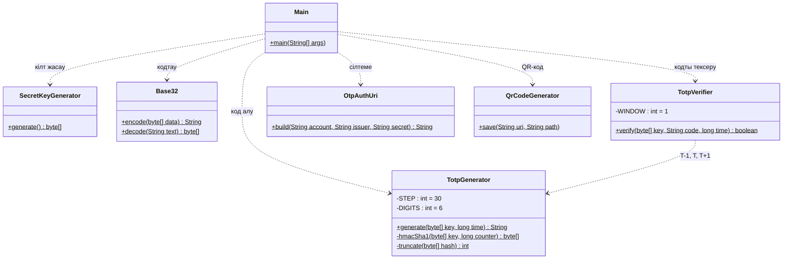

# TOTP генераторы мен тексерушісі

**Пән:** Компьютерлік қауіпсіздік
**Жоба:** №10, орта деңгей
**Орындаған:** 3-курс студенті Махаматдин Даниэлдин
**Тілі:** Java

## Тапсырма

RFC 6238 стандарты бойынша уақытқа негізделген бір реттік құпиясөзді (TOTP) жасайтын және тексеретін Java бағдарламасын жазу. Бағдарлама 6 таңбалы код шығарады, уақыт ауытқуын (±1 қадам) ескереді және Google Authenticator қосымшасымен бірге жұмыс істейді.

## Файлдар

> Жоба аптадан аптаға толықтырылады. Төменде жоспарланған құрылым көрсетілген.

- `src/main/java/totp/Base32.java` — құпия кілтті Base32 форматында кодтау және декодтау
- `src/main/java/totp/SecretKeyGenerator.java` — `SecureRandom` арқылы кездейсоқ кілт жасау
- `src/main/java/totp/TotpGenerator.java` — 6 таңбалы кодты есептеу
- `src/main/java/totp/TotpVerifier.java` — кодты ±1 қадам ауытқуымен тексеру
- `src/main/java/totp/OtpAuthUri.java` — `otpauth://` сілтемесі және QR-код
- `src/main/java/totp/Main.java` — консоль мәзірі
- `src/test/java/totp/` — JUnit 5 тесттері
- `docs/` — теория (Word) және скриншоттар

## Мәселе неде

Тек құпиясөз жеткіліксіз. Оны фишинг, деректердің жылыстауы немесе басқа сайттағы қайталанған құпиясөз арқылы ұрлауға болады. Сондықтан кіру кезінде екінші фактор қосылады: әр 30 секунд сайын өзгеретін 6 таңбалы код. Google, GitHub, банктер осыны қолданады.

Бұл код SMS-ке қарағанда сенімдірек: ол телефонда интернетсіз жасалады және SIM-картаны ауыстыру шабуылына төзімді.

## Қысқаша теория

- **OTP** — бір рет қана жарамды құпиясөз.
- **HOTP** (RFC 4226) — санауышқа (counter) негізделген OTP.
- **TOTP** (RFC 6238) — санауыштың орнына ағымдағы уақыт қолданылады.
- **Base32** — кілтті A–Z және 2–7 таңбаларымен жазу форматы.

Код былай есептеледі:

1. Сервер мен пайдаланушы ортақ құпия кілтті (`K`) бөліседі.
2. Уақыт қадамы есептеледі:

```
T = floor((Unix уақыты - T0) / X),   X = 30 с,  T0 = 0
```

3. `HMAC-SHA1(K, T)` есептеледі, нәтиже 20 байт болады.
4. Динамикалық қысқарту: соңғы байттың төменгі 4 биті ығысуды (offset) береді, сол орыннан 4 байт алынады, жоғарғы бит нөлденеді.
5. Код = `нәтиже mod 10^6`, яғни 6 таңбалы сан.

Телефон мен сервердің сағаты сәл сәйкес келмеуі мүмкін, сондықтан тексеруші `T-1`, `T` және `T+1` қадамдарын тексереді.

## Мен нені жасаймын

1. `Base32` кодтау және декодтау жазамын.
2. `SecureRandom` арқылы кездейсоқ кілт жасаймын.
3. `javax.crypto.Mac` (`HmacSHA1`) арқылы TOTP кодын есептеймін.
4. `TotpVerifier` жазамын, ол ±1 қадамды тексереді.
5. `otpauth://` сілтемесін және QR-кодты ZXing арқылы жасаймын.
6. JUnit 5 тесттерін жазамын, нәтижені RFC 6238 тест векторларымен салыстырамын.

## Класс диаграммасы (UML)

> Жоспарланған құрылым. Код жазылған сайын жаңартылады.



- `Main` барлық класты пайдаланады: кілт жасайды, код шығарады, тексереді, QR-код жасайды.
- `TotpVerifier` кодты тексеру үшін `TotpGenerator`-ды үш рет шақырады: `T-1`, `T`, `T+1`.
- Пунктир көрсеткі «пайдаланады» дегенді білдіреді.

## Апталық прогресс

| Апта | Не істедім | Нәтиже | Күйі |
|---|---|---|---|
| 1 | Теорияны оқыдым (RFC 4226, RFC 6238), жоспар жасадым | Таныстыру құжаты және осы README | ✅ |
| 2 | Maven жобасы, GitHub репозиторийі, кілт генераторы, Base32, орнату нұсқаулығы | Жоба орнатылып, тесттер өтеді, кілт жасалады | ✅ |
| 3 | `HmacSHA1`, динамикалық қысқарту, TOTP генераторы, қолдану мысалы, RFC тест векторлары | Әр 30 с сайын жаңа 6 таңбалы код, RFC мәндерімен сәйкес | ✅ |
| 4 | Тексеруші (±1 қадам), тесттер | Кодтың дұрыс не қате екенін анықтау | ⏳ |
| 5 | `otpauth://` және QR-код, Google Authenticator-мен тексеру, консоль мәзірі | Телефондағы код бағдарламамен сәйкес келеді | ⏳ |
| 6 | JUnit 5 тесттері, README, түзетулер | Дайын жоба | ⏳ |

## Технологиялар

| Технология | Қайда қолданылады |
|---|---|
| Java 17+ | Негізгі тіл |
| `javax.crypto.Mac` (`HmacSHA1`) | TOTP кодын есептеу |
| `java.security.SecureRandom` | Кездейсоқ құпия кілт |
| Base32 | Кілтті кодтау |
| ZXing | `otpauth://` сілтемесінен QR-код жасау |
| JUnit 5, Maven | Тестілеу және жинау |

## Тесттер

Тексеру үшін RFC 6238 тест векторлары қолданылады (SHA-1, кілт: ASCII `12345678901234567890`, 6 таңба):

| Unix уақыты | Күтілетін код | Нәтиже |
|---|---|---|
| 59 | 287082 | ✅ |
| 1111111109 | 081804 | ✅ |
| 1111111111 | 050471 | ✅ |
| 1234567890 | 005924 | ✅ |
| 2000000000 | 279037 | ✅ |

## Қауіпсіздік туралы ескертпелер

- Кілт `SecureRandom` арқылы жасалады, `Random` қолданылмайды.
- Құпия кілт желі арқылы жіберілмейді, тек бір рет тіркеу кезінде беріледі.
- Кодтарды салыстыру тұрақты уақытта жасалады.
- SHA-1 осы жерде HMAC ішінде қолданылады, ол TOTP үшін қауіпсіз болып саналады және RFC 6238 әдепкі мәні.

## Орнату

Қажет: Java 17 немесе жаңарақ, Maven 3.6+, Git.

1. Репозиторийді жүктеп алу:

```bash
git clone https://github.com/Danieldin01/-.git totp
cd totp
```

2. Java мен Maven орнатылғанын тексеру:

```bash
java -version
mvn -version
```

3. Жобаны жинау:

```bash
mvn compile
```

4. Тесттерді іске қосу:

```bash
mvn test
```

Күтілетін нәтиже: `Tests run: 19, Failures: 0` және `BUILD SUCCESS`.

5. Бағдарламаны іске қосу:

```bash
mvn -q compile exec:java -Dexec.mainClass=totp.Main
```

> Java мен Maven өз компьютеріңде жоқ болса, GitHub Codespaces қолдануға болады: онда екеуі де дайын тұр, терминалда 3–5 қадамды орындау жеткілікті.

## Қолдану мысалы

### 1-мысал: жаңа кілт жасау және код алу

```bash
mvn -q compile exec:java -Dexec.mainClass=totp.Main
```

Нәтиже (кілт пен код әр іске қосқанда басқа болады):

```
Secret key (Base32): OTK4CMT4VHFO3EUF4ACXRNUW6SNP6CNP
Decoded key is the same: true
TOTP code: 107723
Valid for (seconds): 15
```

- `Secret key (Base32)` — кездейсоқ құпия кілт, Base32 форматында.
- `Decoded key is the same: true` — кілтті мәтінге айналдырып, кері қайтарғанда өзгермеді.
- `TOTP code` — ағымдағы 6 таңбалы код.
- `Valid for (seconds)` — код тағы қанша секунд жарамды (әр 30 секунд сайын жаңарады).

### 2-мысал: өз кілтіңмен код алу

Кілтті `-Dexec.args` арқылы беруге болады:

```bash
mvn -q compile exec:java -Dexec.mainClass=totp.Main -Dexec.args="JBSWY3DPEHPK3PXP"
```

Нәтиже:

```
Secret key (Base32): JBSWY3DPEHPK3PXP
Decoded key is the same: true
TOTP code: 683649
Valid for (seconds): 15
```

Кілт бірдей болса, код тек уақытқа байланысты өзгереді.

### 3-мысал: Google Authenticator-мен салыстыру

1. 2-мысалдағы сияқты бағдарламаны іске қосып, кілтті көшіріп алу.
2. Телефондағы Google Authenticator қосымшасында жаңа аккаунт қосу, «setup key енгізу» әдісін таңдап, сол кілтті жазу.
3. Қосымшадағы 6 таңбалы код пен бағдарламаның `TOTP code` мәнін салыстыру. Бір 30 секундтық аралықта олар сәйкес келеді.

Телефонның уақыты дұрыс болуы керек, өйткені код уақытқа байланысты есептеледі.

### Тесттер арқылы тексеру

`TotpGeneratorTest` кодты RFC 6238 тест векторларымен салыстырады (мысалы, уақыт 59 болғанда код `287082`). Кестесі жоғарыдағы «Тесттер» бөлімінде.

## Дереккөздер

- RFC 4226: HOTP: An HMAC-Based One-Time Password Algorithm
- RFC 6238: TOTP: Time-Based One-Time Password Algorithm
